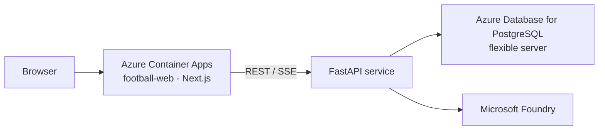

# Reverse Whistle

On-field decisions are often treated as final. Reverse Whistle reviews each call against the laws and precedent cases, with agents collaborating over a full 90-minute simulated match.

**Live:** [Incident](https://football-web.calmsmoke-bc79f6a4.uksouth.azurecontainerapps.io/pitch) · [Overview](https://football-web.calmsmoke-bc79f6a4.uksouth.azurecontainerapps.io/overview)

**Code:** [github.com/BarbaraZhu22/hack-football](https://github.com/BarbaraZhu22/hack-football)

## Architecture



The browser only talks to Next.js. Next.js proxies to the FastAPI service. The service reads the database and calls Foundry.

| Brief | Where |
| --- | --- |
| Real-time match events | Overview, SSE ticks |
| Stories, highlights, recaps | Football-Commentary |
| Explain the moment | Incident 3D review + ruling card |
| Laws and earlier cases | `rules`, `precedents` |
| Studio / stream / fan desk | Overview, Incident, commentary |

Copy and commentary are English.

## Stack

| | |
| --- | --- |
| Web | Next.js 15, React 19, Tailwind CSS 4 |
| Pitch | Three.js, React Three Fiber |
| Agent | FastAPI, Microsoft Agent Framework |
| Model | Microsoft Foundry |
| Database | Azure Database for PostgreSQL flexible server |
| Hosting | Azure Container Apps, UK South (`football-web`) |

## Pages

`/` redirects to `/overview`.

| Route | Nav | Role |
| --- | --- | --- |
| `/overview` | Overview | Live clock, events, decisions, stats, momentum, lineup, commentary |
| `/pitch` | Incident | 3D tackle and offside review, laws, precedents, ruling |
| `/game` | Game | A small football puzzle. Football should always be full of joy. |
| `/match` | — | Static views, not in the nav |

## Repo

```text
apps/web/          Next.js desk
  app/(desk)/      overview, pitch, game, match
  app/api/         proxy only
  components/      layout, overview, pitch, game, three, chat, ui
  lib/             scene commands, incident registry
apps/agent/        FastAPI
  match/           snapshot, SSE, tracking, SQL
  chat/            agents, tools, adjudication
  providers/       Foundry client
  db/              psycopg
```

## Agents

Microsoft Foundry runs three agents. This service does those jobs with tools in `chat/tools.py`. Rules and precedents can be called, read, and called again in one turn. Commentary writes its line without a tool.

| Foundry agent | Tool in this repo |
| --- | --- |
| Football-Commentary | none — it writes one spoken line |
| Football-Rules-Analyst | `search_rules` |
| Football-Precedents-Analyst | `search_precedents` |

| Tool | Returns |
| --- | --- |
| `search_rules` | Law rows for the incident type |
| `search_precedents` | Cases: facts, on-field call, VAR, final call |
| `show_analysis` | Ruling, one-line summary, review of each check |
| `get_incident_capture` | Contact metrics and the current view |
| `control_scene` | Camera, overlay, marker, speed, playback |

| Incident | Precedent types |
| --- | --- |
| tackle | `serious_foul_play` |
| offside | `offside`, `offside_and_red_card` |
| handball | `handball` |
| conflict | `violent_conduct` |

Pitch reconstructs tackle and offside.

## Database

Azure Database for PostgreSQL flexible server (`DATABASE_URL`).

One simulated match, played through 90+3, and a separate library of laws and historical cases.

| Table | Holds |
| --- | --- |
| `events` | The full timeline: clock, players, score, shots and xG, passes, duels, fouls, cards, set pieces, VAR, and each referee decision |
| `frames` | Tracking across the match: ball, players, and possession, aligned to the clock |
| `player_ratings` | A rating for each player at every second |
| `people` | Both squads, named on every event |
| `officials` | The match officials |
| `rules` | Law text, tagged by incident type |
| `precedents` | Historical cases: facts, on-field call, VAR action, final decision, and the law cited |

The server clock is the only clock. The desk joins at 78:32 and moves one second per tick. A snapshot carries the frame and ratings for that second. Replay asks for a tracking window.

## Local

`apps/agent/.env`: `DATABASE_URL`, `FOUNDRY_PROJECT_ENDPOINT`, `FOUNDRY_MODEL`, optional `FOUNDRY_API_KEY`.

```bash
docker compose up --build
```

Web `:3000`, agent `:8088`.
