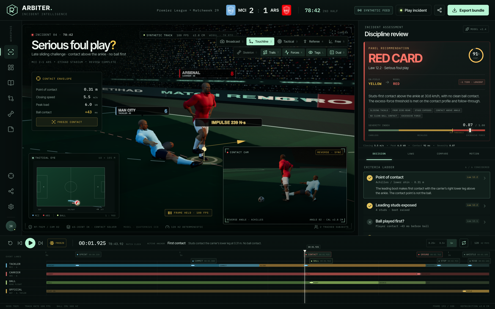
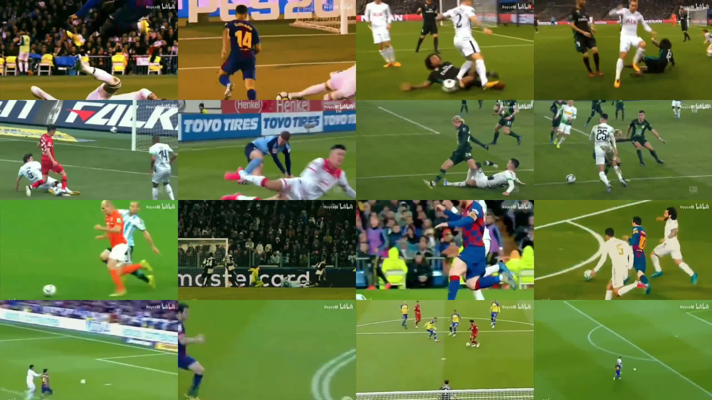

# ARBITER — Premier League Incident Review Workstation

A browser-based, real-time 3D workstation for reviewing a Premier League foul. The demo reconstructs a late side-rear sliding tackle, puts both players, the ball and the pitch into a deterministic contact simulation, and then frames the evidence through a VAR-style decision workflow. The replay is deliberately short: contact, fall, the first half-second on the turf, and the tackler's quick return to his feet.

> **All match, tracking, panel, comparison and physics telemetry is synthetic.** This is not a PGMOL output and does not depict a real incident.



## Run it

```bash
cd /Users/cassie/bristol/dstry
npm install
npm run dev -- --host 127.0.0.1 --port 5173
```

Open **http://127.0.0.1:5173**.

Production build:

```bash
npm run build
npm run preview
```

## What is in the scene

- **Two rigged players** built from the CC0 Quaternius *Superhero Male* glTF human model — 65 joints, textured skin, hair and eyes, fitted to 1.8 m.
- **Procedural kit**: a fitted short-sleeve jersey overlay generated directly from the body mesh (no custom texture), plus shorts, socks and boots, all bound to the same skeleton.
- **A full 3D pitch** drawn into a canvas texture: mowing stripes, all major markings, goal frames, advertising boards, LED ribbon, stadium crowd tiers, floodlights and a big screen.
- **Ball physics**: gravity, quadratic air drag, Magnus side-spin, bounce restitution and rolling. The ball starts at the carrier's feet and leaves the boot after the player contact.
- **Player contact physics**: masses, closing velocity, normal impulse, sliding friction and angular fall state. The tackle continues through contact instead of stopping at the collision.
- **Articulated motion**: the running lead-up is a real Mixamo `Standard_Run` clip retargeted onto the Quaternius skeleton. The contact, slide, fall and recovery use two-bone IK with hinge-constrained knees/elbows, pelvis height, spine recline, shoulder elevation and head/neck orientation, blended into the clip before contact.
- **Reverse-angle contact camera**: a synchronised second view of the same reconstruction, with interface annotations stripped so the contact itself is unobstructed.
- **Skeleton X-ray**: glowing bone visualization plus ghosted body materials.
- **Overlays**: motion trails, ball arc, contact marker, impulse vectors, calibration badge and tactical minimap with live trails.

## Review workflow

- **Timeline**: four event lanes (tackler, carrier, ball, official), key anchors, free scrubbing and frame-step.
- **Decision panel**: required-sanction ladder, severity index against a red-card threshold, six evidence criteria, and a link from each criterion to the relevant camera/frame/overlay.
- **Actual decision analysis**: on-field yellow vs model red, a one-tier leniency finding, panel vote, confidence, and a home-side leniency signal.
- **Law library**: IFAB Law 12.1, 12.2, 12.3, the VAR protocol and the Premier League red-card review explainer.
- **Comparisons**: same-match and same-league neighbours, a league outcome distribution, and a similarity-vector caveat.
- **Kinematics**: joint-angle limits and closing-speed chart.
- **Export bundle**: JSON or Markdown with the incident, criteria, laws, similar incidents, metrics and provenance.

## Controls

| Input | Action |
|---|---|
| `Space` | Play / pause |
| `←` / `→` | Step one frame |
| `F` | Freeze at contact |
| `1`–`5` | Broadcast / Touchline / Tactical / Referee / Free camera |
| `S` | Skeleton X-ray |
| `T` | Motion trails |
| `K` | Force vectors |
| `L` | Player tags |
| `D` | Dual contact view |
| Drag on the timeline | Scrub |

## Architecture

```
src/
  sim/engine.ts        deterministic 120 Hz contact/ball/player simulation
  data/incident.ts     match, criteria, laws, decisions, comparators
  three/Scene.tsx      lighting, stadium, dual-camera renderer, camera follow
  three/Actor.tsx      rig building, IK playback, skeleton overlay, labels
  three/pose.ts        analytic two-bone IK and authored pose states
  three/kit.ts         skinned kit overlay generation and materials
  three/Pitch.tsx      procedural turf, pitch markings, stands, screen, LEDs
  components/          workbench UI, timeline, analysis panel, minimap
  App.tsx              playback clock, review state, export modal
```

The simulation is deterministic for seed `7829`; replaying the same seek or decision restores the same contact frame and camera preset.

## Reference study



Frames from the supplied Bilibili reference compilation were used to study body shape, limb placement and follow-through timing. The source video itself is not redistributed.

## Model / asset provenance

- **Body, skin, skeleton**: [Quaternius Universal Base Characters / Superhero Male](https://github.com/EVEngine/EVEngine/tree/main/examples/character-motion-lab/assets/quaternius), CC0 1.0. The glTF is used as-is; no body mesh was hand-authored.
- **Football kit**: runtime-generated body-topology overlays with team-colour materials; no external or hand-painted textures. The jersey uses the model's own surface so the shirt follows the existing athletic build.
- **Pitch, stadium, ball texture**: generated procedurally in the browser at runtime.
- **Running motion**: Mixamo `Standard_Run` clip, retargeted in the browser. Asset mirror: [MisterYI/deevid-mixamo-assets](https://github.com/MisterYI/deevid-mixamo-assets). Mixamo assets are free to use under Adobe's terms.
- **Reference motion study**: [人类高质量滑铲 滑铲艺术 / Bilibili BV1Zq4y1A7gM](https://www.bilibili.com/video/BV1Zq4y1A7gM/). Frame study is captured in `docs/reference-frames.jpg`; the source video is not redistributed.
- The run is clip-driven; contact, ball release and slide remain IK/impulse-driven so the contact anchor stays editable.
- **Market/UX research**: Hudl Sportscode, Hudl Studio, Opta, TacticalPad, Football Manager, Premier League VAR explanations, FIFA SAOT, Hawk-Eye and IFAB Law 12 informed the timeline, scene-space overlays, criteria-linked review, dual-speed evidence and uncertainty treatment.

## Known limitations

- The contact solver is a deterministic sports-analysis approximation, not a finite-element or full ragdoll solver. Peak force is a heuristic band (±18%), not a measured load.
- Broad result types and comparison percentages are synthetic and should not be read as statistical evidence.
- The kit is a fitted overlay rather than a cloth simulation; at some extreme poses the shorts can clip against the thigh.
- The run clip is retargeted; the contact/fall remain an authored IK response rather than a full mocap ragdoll.
- The project targets desktop widths (1440 px design, usable at 1280 px); mobile layout is intentionally reduced.
- The inset contact camera is a second angle, not a second simulation rate; use the time-scale controls for slow motion.
