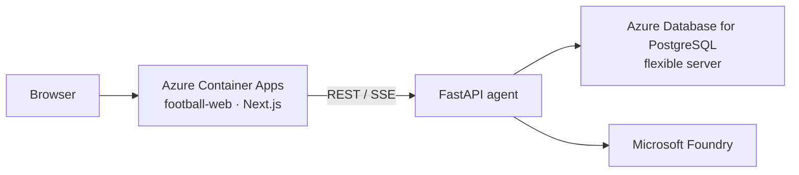

# Reverse Whistle

On-field decisions are often treated as final. Reverse Whistle reviews each call against the laws and precedent cases, with agents collaborating over a full 90-minute simulated match.

**Live:** [Incident](https://football-web.calmsmoke-bc79f6a4.uksouth.azurecontainerapps.io/pitch) · [Overview](https://football-web.calmsmoke-bc79f6a4.uksouth.azurecontainerapps.io/overview)

## Architecture



The browser only talks to Next.js. Next.js proxies to the agent. The agent reads the database and calls Foundry.

| Brief | Where |
| --- | --- |
| Real-time match events | Overview, SSE ticks |
| Stories, highlights, recaps | Commentary agent |
| Explain the moment | Incident 3D review + ruling card |
| Laws and earlier cases | `rules`, `precedents` |
| Studio / stream / fan desk | Overview, Incident, commentary |

Copy and commentary are English.

## Stack

| | |
| --- | --- |
| Web | Next.js 15, React 19, Tailwind CSS 4 |
| Pitch | Three.js, React Three Fiber |
| Agent | FastAPI, Microsoft Agent Framework |
| Model | Microsoft Foundry |
| Database | Azure Database for PostgreSQL flexible server |
| Hosting | Azure Container Apps, UK South (`football-web`) |

## Pages

`/` redirects to `/overview`.

| Route | Nav | Role |
| --- | --- | --- |
| `/overview` | Overview | Live clock, events, decisions, stats, momentum, lineup, commentary |
| `/pitch` | Incident | 3D tackle and offside review, laws, precedents, ruling |
| `/game` | Game | A small football puzzle. Football should always be full of joy. |
| `/match` | — | Static views, not in the nav |

## Repo

```text
apps/web/          Next.js desk
  app/(desk)/      overview, pitch, game, match
  app/api/         proxy only
  components/      layout, overview, pitch, three, chat, ui
  lib/             scene commands, incident registry
apps/agent/        FastAPI
  match/           snapshot, SSE, tracking, SQL
  chat/            agents, tools, adjudication
  providers/       Foundry client
  db/              psycopg
```

## Agent

| Agent | Job | Tools |
| --- | --- | --- |
| Commentary | One spoken line per event | — |
| Adjudication | Ruling card | `show_analysis` |
| Desk | Incident chat | capture, scene, rules, precedents, analysis |
| Follow-up | Later questions | capture, scene |

| Tool | Job |
| --- | --- |
| `search_rules` | Law rows for the incident type |
| `search_precedents` | Past cases: facts, on-field call, VAR, final call |
| `show_analysis` | Ruling, one-line summary, review of each check |
| `get_incident_capture` | Contact metrics and current view |
| `control_scene` | Camera, overlay, marker, speed, playback |

Ruling path: incident facts → `search_rules` + `search_precedents` → `show_analysis`.

| Incident | Precedent types |
| --- | --- |
| tackle | `serious_foul_play` |
| offside | `offside`, `offside_and_red_card` |
| handball | `handball` |
| conflict | `violent_conduct` |

Pitch reconstructs tackle and offside.

## Database

Azure Database for PostgreSQL flexible server. Agent uses `DATABASE_URL`.

| Table | Holds |
| --- | --- |
| `events` | Timeline and referee decisions |
| `frames` | Tracking. Snapshot keeps one frame; tracking route returns a window |
| `player_ratings` | Ratings for the current second |
| `people` | Squad |
| `officials` | Officials |
| `rules` | Laws, tagged by incident type |
| `precedents` | Historical cases |

Clock authority is the server `cursor`. Default entry is 78:32. One tick is one second.

## Local

`apps/agent/.env`: `DATABASE_URL`, `FOUNDRY_PROJECT_ENDPOINT`, `FOUNDRY_MODEL`, optional `FOUNDRY_API_KEY`.

```bash
docker compose up --build
```

Web `:3000`, agent `:8088`.
